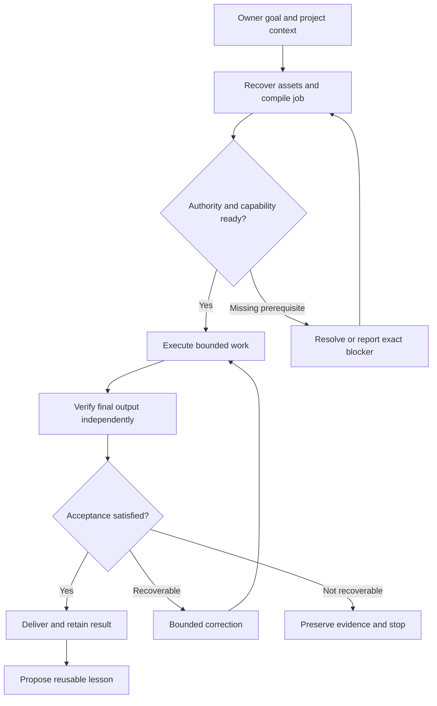
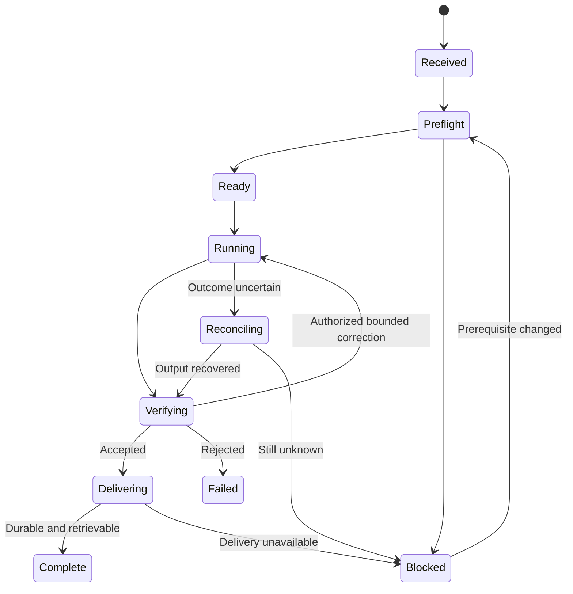

# FOUNDATION Workflow Implementation Plan

Owner-selected implementation specification, adopted November 7, 2026.

This is the canonical workflow specification in this Harness candidate, not an
execution grant or a claim of installed functionality. Apply it with
`OPERATING_CONTRACT.md`. `state/CURRENT_PROJECT.json` remains execution authority;
component pins and the consumed commissioning request are not changed here.
Track implementation evidence in `state/FOUNDATION_WORKFLOW_IMPLEMENTATION.json`.
Private project goals, corrections, conversations and job data stay in the
Workshop's private storage, not this public repository.

The supplied specification follows. Its original status and release observations
are historical context, not a current provider readback.

Prepared for Randy · November 7, 2026
Status: recommended implementation specification. This document does not install, deploy or activate the workflow. It builds on the five-repository audit and the release reports supplied in this conversation; it is not a fresh provider readback.
Give FRIDAY an ordinary-language goal, let the system carry the authorized work, and receive useful output with evidence in the same project. Recover the work after interruptions without reconstructing the conversation. Reuse proven assets and lessons so subsequent jobs require less effort, cost and owner intervention.
The long-term platform supports creative work, software construction, research and owner-supervised businesses. Business revenue is an outcome to validate, not a property conferred by automation. SecAudit is one candidate, not the platform's predetermined destination.
The owner supplies direction, preferences and genuinely consequential decisions. The machine handles context assembly, routine coordination, execution tracking, verification, delivery and bounded recovery. It must not require Randy to copy status between repositories or translate engineering errors into implementation instructions.
No required sixth core repository, new orchestration framework, agent swarm, particular device or self-trained model. Keep the existing components and implement the missing connections.
The latest supplied commissioning report says the real Workshop submission authenticated its owner, reached GitHub and checked out all five repositories. The attempt then failed because authority text was decoded differently on Windows and Linux. A correction reportedly passed 17 local tests; a successful corrected hosted result has not been established here.
That is progress beyond a disconnected interface, but not proof of repeatable delivery. Preserve the failed run and its request. Commissioning the corrected successor is a distinct release activity already being handled by Codex. Do not restart old token, PR or configuration steps based on historical handoffs.
Earlier Harness operating instructions establish useful sequencing, but instructions alone are not a persisted job engine, connected reasoning provider or autonomous business. The implementation below must earn those capabilities through actual behavior.
All repositories are under GitHub owner Karmicmurphy.
FRIDAY is the owner-facing coordinating behavior across these components. It does not require another repository or daemon just to have a name. ChatGPT/Codex remains the external engineering and reasoning resource until an actual connected runtime is implemented and verified. GitHub and Cloudflare provide infrastructure; their presence does not establish an AI reasoning service.

Discovery starts from an active goal, a capability gap, a recovery need or a separately enabled opportunity-watch policy. Search the existing estate before searching the world. Look for mechanisms that can be combined, not merely products with fashionable names.
Return a small ranked set—recommended default: at most three credible candidates per batch. Each needs the specific problem addressed, source evidence, reusable asset, missing work, rights uncertainty, estimated operating cost, cheapest useful experiment and stop condition. Mark unknowns as unknown. Suppress duplicates and known dead ends. A zero-result search is legitimate.
Discovery may prepare a proposal within policy. It does not silently turn brainstorming into a build, purchase, deployment or outreach campaign. Do not create a scheduled watch simply because this document describes one.
Record incidents and repeated work. Propose a rule, script, skill or worker when a stable pattern is observed. Evaluate against relevant prior cases and at least a meaningful case outside the example that motivated it. Promote only when evidence supports the claimed scope; retain rollback and invalidation conditions.
Repeated reruns of the same fixture do not prove generalization. A retained lesson is data, not permission to modify policy or run code. No automatic model training is required.
1. Randy speaks normally in the existing Workshop front door.
2. FRIDAY identifies whether this is a question, brainstorming, a correction, an instruction to work, or a stop. Save useful context without treating every thought as authorization.
3. For work, state the intended result and material assumptions briefly. Use existing project decisions instead of reasking them.
4. Proceed within standing policy. Ask only when the answer changes consequential scope or when an unavoidable prerequisite cannot be resolved with available access.
5. Carry the job through delivery or return one precise blocker with evidence and the smallest necessary owner action.
6. Reopening the project shows the original job and output. It does not resubmit the job.
A normal status message should answer: what is happening, what finished, what is blocked, whether Randy must do anything, and where the result will appear. Keep infrastructure identifiers in expandable evidence rather than the main user flow.
Stop must prevent new work and attempt cancellation where supported. Distinguish cancellation requested from confirmed stopped. Preserve retrieval. Never claim that stopping the UI kills every external process.
The system needs three records with different authority:
Persist the owner intent and job identity before acknowledging admission. Keep a project summary derived from these records, with source links and update time. Summaries are projections, not a second source of authority. An old summary must not overwrite a newer correction.
Minimum job fields: project ID, goal ID, request ID, job ID, attempt ID, provider run ID when applicable, parent request, instruction, acceptance criteria, exclusions, policy version, approval references, immutable source references, input hashes, budget, required capabilities, status, event history, artifact locations, verification and delivery records.
These identifiers serve different purposes. Retrying a technical attempt is not a new owner goal. A new authorized successor request must link to its failed predecessor. Do not reuse a consumed one-shot identity.
Use an existing suitable private persistent store. The exact hosted/local store must be selected from verified available access and deployment constraints; this plan does not mandate a paid database or a PC that must remain on. Assign one authoritative writer per record type. Browser local storage, temporary runner disk and expiring Actions artifacts are not the sole durable copy.
Private creative drafts, life history and raw chats stay out of public Harness Git history. Public policy can refer to opaque private records. Support export, restore and integrity verification. A backup claim requires a successful restoration demonstration.
Before execution, recover relevant existing code, artifacts, prior outputs, licenses, failures and lessons. Assemble a bounded context packet tied to the current goal. Do not load all five repositories into every reasoning call.
Classify an asset as usable now, usable after adaptation, unproven, incompatible, or excluded. Explain the missing delta. Historical branches and PRs are candidates; they are not installed capabilities or authorization to merge an entire branch.
Recommended routing order:
1. Retrieve an existing valid result when the owner is asking for it.
2. Reuse a verified artifact or cache entry if its inputs, source, policy, environment and freshness conditions still match.
3. Run a deterministic rule, script or supported worker.
4. Use a specialized tool or skill procedure with explicit inputs and outputs.
5. Call an adequate reasoning model for ambiguity, planning, synthesis or novel code.
6. Escalate a genuinely owner-only decision.
This is a decision ladder, not a requirement to try every rung. Skill documentation does not execute itself. A model response can propose a typed job; it cannot grant itself permissions. Route unsupported work to an honest capability gap rather than a fake completion.
A capability is usable only when implementation, configuration, authorization, reachability and behavior for the relevant scope are established. Keep these states separate in the capability catalog. Referenced in README is not operational.
Preflight checks the actual target environment, owner boundary, source refs, policy binding, credential availability and expiry metadata, expected input/output schema, execution isolation, budgets, proof method and durable output destination. Do not expose credential values in logs.
For source and authority hashes, define and version the serialization. Read textual authority files explicitly as UTF-8 and define handling of BOM, line endings and JSON canonicalization. Hash exact bytes where that is the contract; do not silently normalize a byte-bound manifest. Prove the chosen contract against Windows and Linux fixtures containing non-ASCII text. A changed digest contract requires an explicit reviewed binding, not an unexplained replacement hash.
No inference service is assumed. Catalog the real provider, model, access mechanism, cost boundary, availability and permitted data. Chat subscriptions and deployed API access are separate matters. If reasoning is unavailable, deterministic supported jobs can still work; reasoning-required jobs must report the missing capability.
Use a persisted state machine and atomic admission. Recommended states:

Cancellation and owner-decision states must also be represented in implementation. Record every transition with a reason. Use compare-and-set or equivalent concurrency control and correlate external requests. Persist the dispatch intent before sending.
Do not promise universal exactly-once execution. Use idempotency where supported, prevent duplicate admission, and reconcile ambiguous external outcomes before retrying. A timed-out dispatch may already have happened. An expired execution lease does not establish that a worker stopped; do not blindly start a competing worker.
Recommended initial recovery budget: one initial attempt plus up to two corrections for identified recoverable failures, within the same total time/cost budget. This is a proposed default, not a measured optimum. Permanent denial, changed authority, unsupported capability or uncertain side effects require reconciliation or a blocker, not repeated retries. Any request's stricter one-shot limit takes precedence.
Retrieval, report rendering and artifact download must not repeat execution. A delivery failure should resume delivery. Failure to retain a lesson should be visible as a separate incomplete subtask rather than silently discarding a completed useful output.
Workers need appropriate OS/process isolation for untrusted execution. Cooperative Python budgets and capability checks are useful controls, not a substitute for isolation against malicious code.
The verifier must check final delivered bytes through a separately defined path, not trust the worker's success field. A hash proves integrity relative to recorded bytes; it does not by itself prove correctness, authorship, compliance or independent certification.
SecAudit's specification checks must not be marketed as a penetration test, SOC 2 certification or proof of runtime security. Synthetic orders prove software paths, not willingness to pay or earned revenue. Creative work must not be rejected because an invented objective score substitutes for taste.
Deliver the useful artifact, a concise explanation, relevant limitations and an inspectable receipt in the originating Workshop project. Reopen and retrieve the original output after the worker exits. That is part of completion.
Harness should express reusable policy for classes of action, with scope, resource limits, expiry/revocation and evidence requirements. Bind jobs to that policy. Do not require a fresh ceremonial approval for every ordinary implementation detail already covered.
Examples of work suitable for standing policy: read authorized sources; create an isolated reversible patch; run bounded approved tests; retrieve existing output; correct a known failure inside the same task; prepare a reviewable deployment. Publication or production changes may also be automated when the owner's actual policy covers the exact action and risk boundary.
An approval is reusable only while its relevant scope and conditions still hold. Do not treat authorization for one token, budget or hostname as authorization to change unrelated boundaries. Do not manufacture new gates from conservative wording in an old handoff. When a gate is unavoidable, identify the precise changed condition and present one finished, consolidated decision.
Default incremental spending boundary: $0 unless Randy establishes another cap. Enforce available provider limits and job budgets; do not infer zero cost from missing usage data. Payment-account identity checks and private credential entry may still require the owner when available tools cannot perform them. Never ask for tokens in chat.
Brainstorming business ideas does not authorize customer outreach, purchases, taking payments or reinvestment. Those become routine only under a separately agreed business operating policy.
For each incident retain the observed failure, affected scope, cause confidence, correction, evidence, cost and prevention candidate. Distinguish facts from hypotheses.
For each reusable lesson retain source job, final artifact/certificate references, applicable inputs, environment assumptions, rights evidence, proof, counterexamples, expiry or invalidation conditions and rollback target. Sanitize private data. Verify current conditions before reuse.
Promotion ladder: observed pattern → candidate procedure → evaluated script/skill → bounded default behavior. Promote only to the demonstrated scope. A script replacing repeated model work is a measurable improvement. Writing a lesson file without using it is retention, not demonstrated learning.
Track owner interventions per useful completed job; elapsed time to usable result; successful restart retrieval; duplicate dispatches; repeated known failures; measured compute/model cost; and proven reuse. Unknown cost remains unknown. Passing-test counts are supporting evidence, not the primary product metric.
These are source leads for fresh inspection, not instructions to bulk-merge old code:
Maintain the five currently approved source pins unless the implementation explicitly reviews and records a change. The audit's snapshot SHAs are historical observations, not new release authorization.
Prepare design and isolated patches while the separate commissioning repair proceeds. Do not mutate its request binding concurrently. Each package should produce useful behavior, not just more documentation.
Some work can overlap, but do not claim the integrated package is complete from isolated unit tests. Use focused regression checks for changed behavior and one integrated acceptance demonstration; avoid repeating the entire five-repo campaign after every documentation edit. Preserve failures instead of weakening guards to get green checks.
The first general useful job could recover Randy's actual TWIS architecture into a usable, source-linked project packet. A creative alternative could assemble an existing song/story project's canon and sources, then produce a requested draft. Choose from his real current priority, not from whichever fixture is easiest.
Implement the FOUNDATION workflow described in this document using the existing five machine repositories. The intended owner experience is: ordinary-language goal → authorized work carried by the machine → verified useful output retained and retrievable in the same Workshop project, with routine coordination and recovery handled automatically.
Start with fresh read-only reconciliation of the canonical Harness state, the latest local release checkpoint, current branches/worktrees and provider evidence. Treat historical handoffs and this document as context, not proof of current deployment. Do not restart completed gates or overwrite another active release effort. Resume the corrected commissioning successor at its actual checkpoint if that task is yours; otherwise preserve it and prepare the nonconflicting workflow work.
Inventory the existing implementations listed above before adding infrastructure. Produce a small implementation map naming the exact selected code, missing connections, durable state authority, capability status and acceptance evidence. Favor adaptation of coherent existing code over whole-branch merges or another orchestrator.
Implement Packages B–F incrementally around the commissioned path. Generalize supported jobs through typed contracts rather than new hardcoded sentences or one-off workflows. Preserve separation between owner policy, execution facts, project canon and learned guidance. Use explicit portable encoding, immutable refs, bounded execution, duplicate prevention, uncertain-outcome reconciliation, independent final-output verification and durable delivery.
Respect standing authorization and continue routine reversible work without making Randy act as the integration engineer. Consolidate any genuinely new consequential decision into one reviewable packet with exact scope and evidence. Do not create credentials blindly, introduce unapproved spend, or silently convert brainstorming into external action. Never pretend a connected tool or declared adapter proves a working model.
Deliver code and meaningful validation for each package, plus a short owner-facing status: usable now; still unproven; exact next action; any unavoidable owner step. Update canonical records and generated projections consistently. Finish with a real useful job, reopen its original result after execution ends, and demonstrate that the next session can continue without Randy rebuilding context.
Randy can give one supported useful job through Workshop, leave, return later and retrieve the verified output. A restart does not lose the goal or cause duplicate execution. A known recoverable failure is handled inside policy. An unsupported task produces an honest blocker. At least one later job reuses a verified asset or procedure. Costs and owner-only exceptions are visible.
This is a practical first machine. General autonomous company operation remains a later capability to establish through repeated customer work, not a launch label.
The detailed five-repository audit saved as FOUNDATION_FIVE_REPOSITORY_AUDIT_2026-11-06.md, the release reports and owner corrections in this conversation, and the owner's stated creative/software/business goals. Architectural choices and default budgets in this plan are recommendations. No new repository review, runtime installation, provider configuration, deployment or dispatch is claimed by this document.
